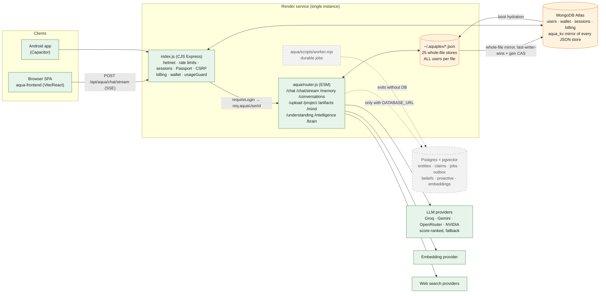
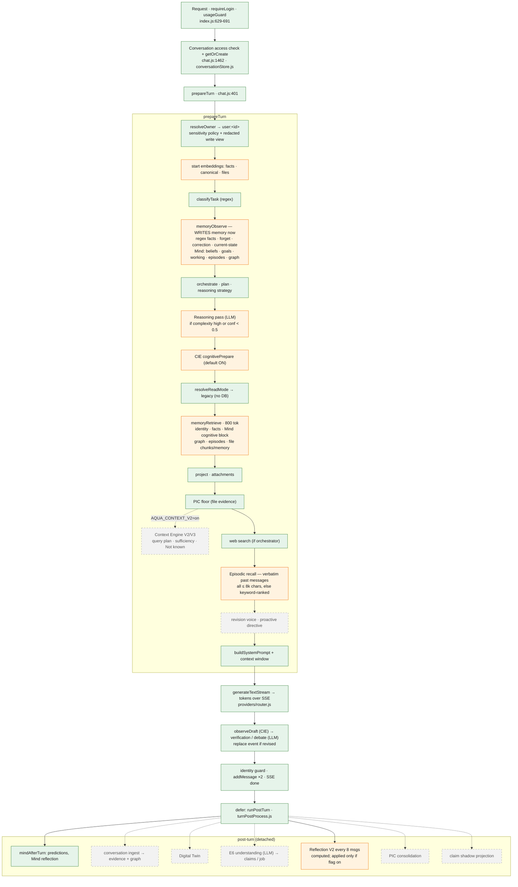
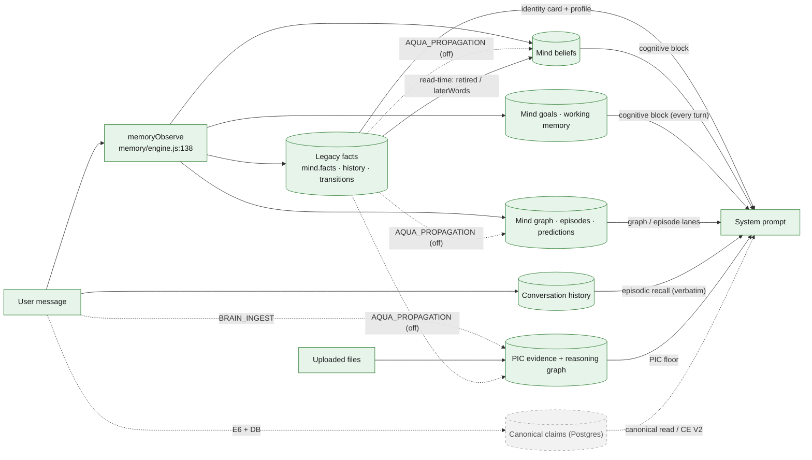

# AQUIPLEX Architecture Map (as built, 2026-11-10)

**HEAD:** `839ea0d1`. Part of the [Production Intelligence Audit](AQUIPLEX_PRODUCTION_INTELLIGENCE_AUDIT.md). This is the existing system, not a target design.

Legend used in all diagrams: **solid green** = runs in the documented production configuration (code defaults, no Postgres) · **dashed grey** = exists but inert in production (flag off by default, or needs Postgres) · **orange** = runs, with a finding attached.

## 1. Deployment topology

Orange: [F-10](AQUIPLEX_PRODUCTION_INTELLIGENCE_AUDIT.md#f-10) (all users per file, single instance), [F-20](AQUA_KNOWLEDGE_ARCHITECTURE_AUDIT.md#f-20) (boot-hydration overwrite).

## 2. One chat turn (`POST /chat/stream`, `routes/chat.js`)

Orange nodes and their findings: C2 [F-13](AQUIPLEX_PRODUCTION_INTELLIGENCE_AUDIT.md#f-13) · C4 [F-04](AQUIPLEX_PRODUCTION_INTELLIGENCE_AUDIT.md#f-04), [F-12](AQUIPLEX_PRODUCTION_INTELLIGENCE_AUDIT.md#f-12) · C6 [F-07](AQUIPLEX_PRODUCTION_INTELLIGENCE_AUDIT.md#f-07) · C7 [F-02](AQUIPLEX_PRODUCTION_INTELLIGENCE_AUDIT.md#f-02) · C9 [F-06](AQUIPLEX_PRODUCTION_INTELLIGENCE_AUDIT.md#f-06), [F-09](AQUIPLEX_PRODUCTION_INTELLIGENCE_AUDIT.md#f-09) · C13 [F-05](AQUIPLEX_PRODUCTION_INTELLIGENCE_AUDIT.md#f-05) · G5 [F-18](AQUIPLEX_PRODUCTION_INTELLIGENCE_AUDIT.md#f-18). C14 returns '' without Postgres.

## 3. Where one user statement goes

"I now work at Northbeam" — writers on the left, the prompt sections that read each store on the right.

With propagation off, a change reaches the Mind copies only as read-time filtering ([Knowledge §2 Q3–Q6](AQUA_KNOWLEDGE_ARCHITECTURE_AUDIT.md)); the evidence lane holds chat sentences only when ingest is on.

## 4. Module index

| Area | Path | Entry points |
|---|---|---|
| Chat pipeline | `aqua/src/routes/chat.js` | `prepareTurn`, `router.post('/')`, `router.post('/stream')`, `runVerification`, `memoryWriteTurn` |
| Post-turn | `aqua/src/routes/turnPostProcess.js` | `runPostTurn` |
| Memory facade | `aqua/src/memory/engine.js` | `memoryObserve`, `memoryRetrieve`, `legacySupersessionNotes`, `uncertaintyNotes`, `rememberFile` |
| Fact store | `aqua/src/memory/longTermMemory.js`, `factChange.js`, `memoryRetriever.js`, `memoryExtractor.js`, `candidateExtractor.js` | `storeFact`, `applyCurrentState`, `retrieveRelevantFacts`, `extractFactsWithReport` |
| Recall | `aqua/src/memory/episodicRecall.js`, `semanticRecall.js`, `recallRedactions.js` | `recallForTurn` |
| Propagation | `aqua/src/memory/propagation.js` | `recordTransitions`, `reconcileMind`, `withTransitions`, `startPropagationSweeper` |
| Mind | `aqua/src/mind/` | `mindObserve`, `mindContext` → `retrieveCognitiveContext`, `mindAfterTurn`, `mindStore` |
| PIC | `aqua/src/pic/core.js`, `retrievalIntelligence.js`, `questionShape.js` | `retrieveKnowledge` (lanes 1–7) |
| CIE | `aqua/src/cognition/index.js` | `cognitivePrepare`, `cognitiveKnowledgeRetrieve`, `observeDraft` |
| Brain facade | `aqua/src/brain/index.js` | `resolveReadMode`, `legacyVetoFor`, `assembleContextAsync`, `canonicalSemanticScores`, `understandTurn`, `observeConversationTurn`, `reflectTurn`, `revisionDirectiveForTurn` |
| Context Engine | `aqua/src/brain/contextEngine/` | `assembleTurnContextAsync`, `buildQueryPlan`, `assembleContext`, `scorer` |
| E6 | `aqua/src/brain/understanding/pipeline.js` | segmentation → gate → extraction → validation → temporal → entity resolution |
| Reflection | `aqua/src/mind/reflectionEngine.js`, `brain/reflectionV2/`, `brain/reflectionV3/`, `cognition/reflectionEngine.js` | four modules ([Knowledge §4](AQUA_KNOWLEDGE_ARCHITECTURE_AUDIT.md)) |
| Stores | `aqua/src/core/dataDir.js`, `atomicStore.js`, `mongoMirror.js`, `core/storage/`, `core/db/` | `hydrateFromMongo`, `createDebouncedWriter` |
| Jobs | `aqua/src/core/jobs/`, `aqua/scripts/worker.mjs` | `enqueue`, `runOneJob`, `HANDLERS` |
| Providers | `aqua/src/providers/router.js` | `generateText`, `generateTextStream` |
| Flags | `aqua/src/core/flags.js` | `GATES`, `flagReport`, `flagBootLine` |
| Deletion | `aqua/src/account/accountPurge.js` | `purgeOwnerData` |
