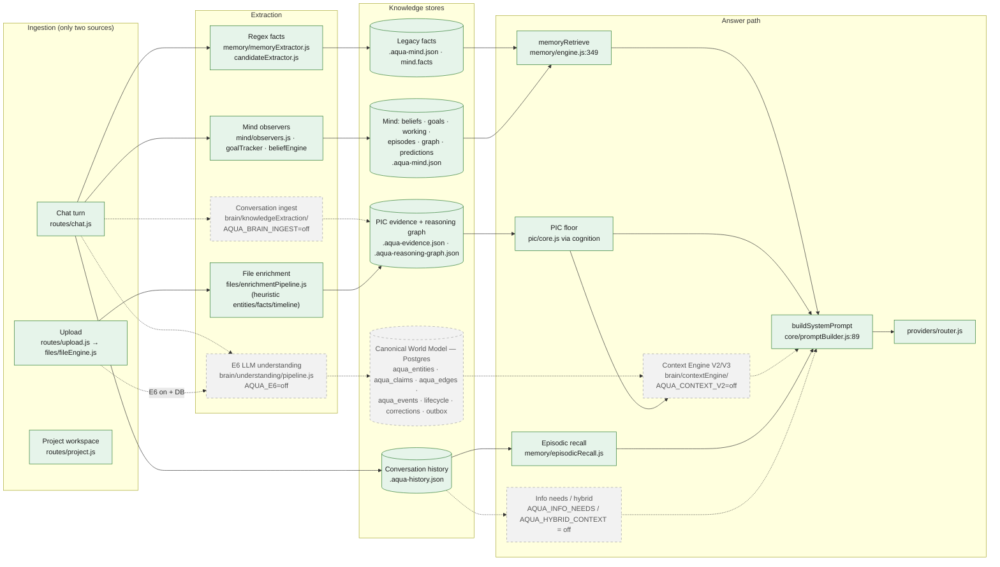
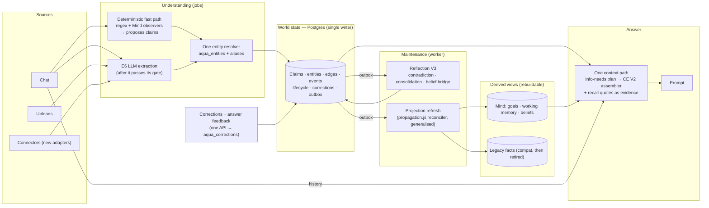

# AQUIPLEX — Personal World Intelligence: Forensic Architecture Audit

**Date:** 2026-11-15 · **Tree:** `main` @ `839ea0d1` plus the large uncommitted working tree (Phases 2–4B, Sprints 1–6). **No source file was modified.** This document is the only file added.

**Scope:** what exists today, what runs, what is disconnected, and what must change for Aqua to *continuously build, maintain and apply an accurate, evolving understanding of a user's digital world*. It re-verifies the 2026-11-10 audit ([Production Intelligence Audit](AQUIPLEX_PRODUCTION_INTELLIGENCE_AUDIT.md), [Knowledge Architecture](AQUA_KNOWLEDGE_ARCHITECTURE_AUDIT.md), [Context Engine](AQUA_CONTEXT_ENGINE_AUDIT.md), [Architecture Map](AQUIPLEX_ARCHITECTURE_MAP.md)) against the current tree, and adds what the PWI direction needs. Where the earlier documents are still right, this one links to them rather than repeating them.

**Evidence labels**

| Label | Meaning |
|---|---|
| **X** | Verified by execution in this audit (isolated probe, see Appendix A) |
| **V** | Verified by reading the code path end to end; file:line cited |
| **H** | Measured in an earlier session; not re-run here (source named) |
| **U** | Uncertain — not verified; says what would settle it |

**Configurations.** Behaviour depends on two things more than on any module: whether `DATABASE_URL` is set, and the flags. Three configurations matter:

| Name | What it is | Where it applies |
|---|---|---|
| **PROD-NOW** | Render, code-default flags, no Postgres (legacy read) | Production today (2026-10-29 context validation; [F-01](AQUIPLEX_PRODUCTION_INTELLIGENCE_AUDIT.md)) |
| **CLOUD-RUN** | `deploy/cloudrun/api.service.yaml` as written: Postgres + partitions + durable post-turn, every other flag default | Phase 5 target (not deployed) |
| **CANONICAL** | Postgres + `AQUA_E6=on` + `AQUA_CONTEXT_V2=on` | Only in eval/test runs |

---

## Executive summary

1. **Aqua has three world models, and none of them is the user's world.**
   - The **legacy fact store + Mind** (JSON files) is the only one that serves answers in production.
   - The **canonical World Model** (Postgres: bitemporal claims, lifecycle, provenance, outbox, Reflection V3) is the most complete design in the repository, and it is empty in production. Its only writer, E6, is off, and production has no database.
   - The **PIC evidence layer + reasoning graph** holds file knowledge only.

   `brain/worldModel/` is a read-only projection that joins two of these; it is not a store. **V**
2. **Which store is authoritative is decided by configuration, not by design.** The mode comes from `canonicalReadMode()` ([brain/index.js:116](aqua/src/brain/index.js#L116)). In PROD-NOW nothing decides what is true: four stores are injected into one prompt, and the model reconciles them. **V**
3. **Critical (S1): the planned Cloud Run configuration silently removes the Mind from every answer.** Setting `DATABASE_URL` without `AQUA_CANONICAL_READ` switches the read mode to `authoritative`. That mode drops the cognitive block (goals, blockers, deadlines), the graph lane and the episode lane ([engine.js:374](aqua/src/memory/engine.js#L374)). Nothing replaces them:
   - canonical claims reach the prompt only through Context Engine V2, which is off;
   - the canonical store has no writer, because E6 is off.

   Probe: the memory block for the same user and question fell from 1,219 to 735 characters, and goals and working memory disappeared. **X.** No journey or test checks for this. **V**
4. **Ingestion is chat and file uploads only.** There is no connector to email, calendar, documents, tasks or code hosts. Google OAuth requests `profile email` only ([index.js:1490](index.js#L1490)). A "digital world" today means what the user typed or uploaded. **V**
5. **Production extraction is regex-based.** The LLM extractor (E6) measured 0.495 strict accuracy and 85% negation detection against a 95% gate (**H**). That gap is the real blocker on making the canonical model authoritative, more than any piece of plumbing.
6. **Corrections reach one store, and nothing learns from them.**
   - Edits on the memory page go through `withTransitions`, which is a pass-through while `AQUA_PROPAGATION` is off ([propagation.js:832](aqua/src/memory/propagation.js#L832)).
   - Canonical corrections are recorded in `aqua_corrections`, but are read only for idempotency and metrics.
   - There is no answer-level feedback anywhere: no UI and no API.

   **V**
7. **Evaluation is strong at the context level and absent at the world-state level.** ACIB v1/v2, held-out sets and the eval gate exist. Nothing measures, on the production configuration, whether Aqua's model of a user stays *correct over time*, meaning currency, supersession, attribution and forgetting. No paid answer-level run has been executed. **V/H**
8. **No rewrite is needed.** Postgres is arriving with Phase 5, and it is the substrate the canonical model was built for. The convergence machinery already exists:
   - the claims shadow projector;
   - the propagation outbox;
   - Reflection V3 workers;
   - the document-understanding job;
   - the information-needs engine.

   What is missing is three decisions and the wiring between these pieces (§8, §9).

---

## 1. Current architecture

### 1.1 Components and the stores they own



Solid green = runs in PROD-NOW. Dashed grey = exists but does not run in PROD-NOW (flag off and/or needs Postgres).

### 1.2 The three "world models" and what each really is

| Name in code | Path | What it is | Writes? | Serves answers in PROD-NOW? |
|---|---|---|---|---|
| Legacy facts + **Mind** | `memory/longTermMemory.js`, `mind/*` | key→value facts with history/transitions + cognitive model | Yes, every turn | **Yes — the only personal-state source** |
| **Canonical World Model** | `core/worldModel/*`, `core/claims/*`, migrations 0005–0025 | entities, typed claims (polarity, modality, `valid_from/valid_to/asserted_at`, lifecycle states, `superseded_by`), evidence, edges, events, corrections, transactional outbox | Only E6 commit (`AQUA_E6=on` + DB), `e10Migration` backfill, user corrections via `/brain/claims/*` | No (no DB) |
| **Brain World Model** | `brain/worldModel/projection.js`, `schema.js`, `annotationStore.js` | *Read projection* joining reasoning graph (files) and Mind graph (chat) on normalized name; plus a curated annotation overlay | Annotations only ("cannot hold knowledge" by design) | `/brain` API + timeline view only, not chat |

**V** — projection.js header lines 1–30 ("PROJECTION, NOT STORAGE … Nothing here is written back").

---

## 2. Execution flow: user input → final answer

Traced through `POST /api/aqua/chat/stream` ([chat.js:1601](aqua/src/routes/chat.js#L1601)), whose preparation is `prepareTurn` ([chat.js:430–973](aqua/src/routes/chat.js#L430)). Every step below is **V** unless marked.

| # | Step | Code | Effect on PWI |
|---|---|---|---|
| 0 | Auth, rate limits, wallet/usage guard, CSRF | `index.js` → `aqua/router.js:241–268` | `req.aquaUserId` → owner |
| 1 | Resolve the one memory owner `user:<id>` (conversation fallback) | `resolveOwner` chat.js:435 | Every store keys on this string |
| 1a | Sensitive-category policy + redacted write view | chat.js:441–445 | Health/mood not stored unless opted in |
| 1b | Start embeddings (facts, canonical claims, file chunks, recall vector) | chat.js:451–465 | Fail-open to keyword |
| 2 | `classifyTask` (regex) | chat.js:489 | Drives budget, review depth |
| 2a | **`memoryObserve` — WRITES** before anything else | chat.js:519 → engine.js:139 | Regex facts → `storeFacts`; forget; correction; current-state (`applyCurrentState`); `recordTransitions` (no-op unless propagation on); `mindObserve` (beliefs/goals/working/episodes/graph). Rolled back if the turn fails (`beginTurnMemory`, Sprint 1) |
| 2b | Orchestrator, execution plan, reasoning strategy | chat.js:538–550 | — |
| 2c | Internal Intelligence Engine (may run a reasoning-pass LLM call) | chat.js:553 | — |
| 2d | CIE `cognitivePrepare` (on by default) | chat.js:579 | Evidence posture / directive |
| 3 | **`Brain.resolveReadMode`** → `legacy` / `authoritative` / `canonical`; degrades to legacy if DB unreachable | chat.js:597, brain/index.js:141 | **Decides which knowledge is allowed in** |
| 3a | **`memoryRetrieve`** — identity card, ranked facts, *Mind cognitive block, graph lane, episode lane (legacy mode only)*, file chunks, file memory; 800-token budget | chat.js:602, engine.js:349–560 | See §6 C-1 |
| 5b | Project/workspace retrieval (orchestrator or repo-intent) | chat.js:630–654 | — |
| 5c | Conversation attachments (always) | chat.js:662 | — |
| 5c¹ | Information-needs engine (off) — would *replace* personal lanes | chat.js:682–715 | — |
| 5c² | **Knowledge lane**: PIC floor via CIE; **Context Engine V2 only if `AQUA_CONTEXT_V2=on`** (the only path by which canonical claims enter the prompt) | chat.js:728–799; gate at :744 | See §6 C-1 |
| 5d | Web search (orchestrator) | chat.js:808–825 | — |
| 5d² | **Episodic recall**: verbatim, dated user quotes; whole history ≤ 8,000 chars else ranked; supersession notes | chat.js:837–855 | Strongest evidence lane in prod (**H**, 2026-10-20 / 11-10) |
| 5d³ | Hybrid needs-check block (off) | chat.js:860–875 | — |
| 6 | Revision voice (canonical; legacy fallback only when `=on`) + proactive directive (needs DB) | chat.js:924–935 | Inert in PROD-NOW |
| 6a | **`buildSystemPrompt`** — memory block unfenced; attachments + project + knowledge + recall concatenated and fenced as untrusted; **no truncation** | chat.js:938, promptBuilder.js:89–150 | Everything retrieved reaches the provider intact |
| 7 | History window + `optimizeContext` | chat.js:941 | — |
| 8 | `generateTextStream(systemPrompt, messages)` | chat.js:1803 | Provider rejects oversized prompts; no input trimming in `providers/*` |
| 9 | CIE draft monitor → verification / debate (may replace the draft) | `runVerification` chat.js:995 | `recordReasoningOutcome` → PIC feedback (chat.js:1047) |
| 10 | Persist messages; `commitTurnWithLearning` (durable, `AQUA_POST_TURN_DURABLE`) **or** `runPostTurn` (in-process) | chat.js:1872–1930, turnPostProcess.js:164/381 | Learning after the answer |
| 11 | Post-turn: Mind after-turn (predictions; Mind reflection every 8 turns); conversation ingest (off); claim shadow (off); Twin (off); **E6 (off)**; Reflection V2 (computed every 8 turns, *applied* only if `AQUA_REFLECT_V2=on`); PIC consolidation (off) | turnPostProcess.js:170–340 | Only the Mind learns in PROD-NOW |

**Does retrieved knowledge reach the final request?** Yes, for whatever the lanes select:

- `buildSystemPrompt` concatenates every block it receives;
- no layer trims the input (searched `providers/*.js`, `core/contextOptimizer.js`, `core/tokenManager.js`);
- "Context used" (`contextUsedItems`, chat.js:1098) checks each item against the final `systemPrompt` text.

The losses happen *before* the prompt, in lane selection and read-mode gating. **V**

---

## 3. Component-by-component status

Status vocabulary: **Active** (runs in PROD-NOW) · **Inert** (complete, gated off or needs DB) · **Partial** (runs but incomplete for its stated purpose) · **Disconnected** (built, no production caller or its output goes nowhere) · **Duplicate** (overlaps another active component) · **Missing**.

### 3.1 Knowledge ingestion

| Component | Path / entry | Status | Evidence |
|---|---|---|---|
| Chat observation | `memoryObserve` engine.js:139 | **Active** | V; called unconditionally chat.js:519 |
| Conversation history | `memory/conversationStore.js` | **Active** | V |
| File upload → UKO → enrichment | `routes/upload.js:66` → `files/fileEngine.js:66` `ingestFiles` → `enrichmentPipeline.js` (metadata, keywords, entities, topics, timeline, facts, summary, reasoningHints; then embeddings, memoryLink→`rememberFile`, searchIndex) | **Active** | V |
| File → reasoning graph rebuild | fileEngine.js:140 `rebuildOwnerGraph` | **Active** | V |
| File → canonical claims | `files/documentUnderstanding.js:76` `enqueueDocumentUnderstanding` → job `understanding.document` | **Inert**; it runs only when `isConfigured() && e6Enabled() && e6CommitEnabled()` (:83) | V |
| Chat → evidence lane | `brain/knowledgeExtraction/conversationIngest.js` | **Inert** (`AQUA_BRAIN_INGEST` off) | V |
| Project workspaces (zip/repo) | `routes/project.js`, `project/*` | **Active** for code workspaces | V (route); depth not audited |
| External connectors (mail, calendar, drive, docs, tasks, chat apps, code hosts) | — | **Missing** | V: no client, no OAuth scope beyond `profile email` (index.js:1490, 1697, 1801); grep of `gmail|calendar|drive|notion|slack|github|imap|outlook|webhook` finds vocabulary only |

### 3.2 Knowledge extraction

| Component | Path | Status | Evidence |
|---|---|---|---|
| Regex fact extractor + candidate extractor, speech-act gate, digit-aware terminators | `memory/memoryExtractor.js`, `candidateExtractor.js`, `understanding/speechAct.js` | **Active** | V; capture gaps **H** (team size, funding, departures, third-party attributes uncaptured — 11-10 probe) |
| Current-state / change detection | `memory/factChange.js` via `applyCurrentState` | **Active** | V engine.js:256 |
| Mind observers (beliefs, goals, working memory, episodes, graph) | `mind/observers.js`, `goalTracker.js`, `beliefEngine.js`, `relationshipGraph.js` | **Active, Duplicate** (second extractor over the same message) | V engine.js:304 |
| File heuristics | `files/factBuilder.js`, `reasoning/entityResolver.js` | **Active** | V |
| E6 understanding (segmentation → candidate gate → LLM extraction → validation → temporal normaliser → entity resolution → dedup → commit plan) | `brain/understanding/*`, `Brain.understandTurn` brain/index.js:1259 | **Inert** (`AQUA_E6` off); quality below gate **H** (strict 0.495, predicate 0.473, negation 85% vs 95%) | V wiring; H quality |
| Claim dedup (S8, bounded history) | `brain/understanding/claimDedup.js`, migration 0025 | Inert (DB) | V |
| Claims shadow projector (legacy evidence → claims, parity report) | `core/claims/shadowProjector.js`, `projection.js` | **Inert** (`AQUA_CLAIMS_SHADOW` off; fed by conversation ingest which is also off) | V turnPostProcess.js:207–212 |

### 3.3 World model

| Component | Path | Status | Evidence |
|---|---|---|---|
| Canonical schema (bitemporal claims, lifecycle, provenance, corrections, outbox) | migrations 0005–0025 | **Inert** in PROD-NOW; schema complete | V 0006_claims.sql:47–95 |
| Canonical read model | `core/worldModel/canonicalReadModel.js` | Inert | V |
| Read-mode authority switch | `canonicalReadMode` / `resolveReadMode` / `legacyVetoFor` brain/index.js:116–203 | **Active** (always resolves `legacy` in PROD-NOW) | V |
| Valid-time queries | `canonicalReadModel.js:692` `currentOnly` filter only | **Partial**: there is no point-in-time ("as of March") read | V |
| Entity resolution | five resolvers: `reasoning/entityResolver.js` (files), `mind/relationshipGraph.js` (chat, normalized label), `brain/understanding/entityResolution.js` (E6 S6 over `identity/entityStoreView.js`), `brain/identity/canonicalId.js` (`AQUA_CANONICAL_IDS` off), `brain/worldModel/projection.js` (join on normalized name) | **Duplicate**; prod uses the first two | V (paths); cross-resolver agreement **U** |
| Self entity | `brain/identity/selfEntity.js` (`AQUA_SELF_ENTITY` off) | Inert | V |
| Brain projection + annotations | `brain/worldModel/*` | Active for `/brain`, not in chat | V |
| Legacy supersession / history | `longTermMemory.js` history, transitions, ended, laterWord, retiredItems | **Active** | V |

### 3.4 Reflection

| Implementation | Path | Trigger | What it processes | Writes to | Status |
|---|---|---|---|---|---|
| **Mind reflection** | `mind/reflectionEngine.js` (`REFLECT_EVERY_TURNS = 8`) | `memoryAfterTurn` post-turn | Mind beliefs/goals: promotion, decay, temporary-item expiry | Mind | **Active — the only reflection that changes production state** (V) |
| **Reflection V2** | `brain/reflectionV2/index.js:78` `reflectWorldModel` | `runPostTurn` every 8 messages (turnPostProcess.js:312–319) | Snapshot of the *reasoning graph* (files; chat only with ingest) diffed against stored snapshot + obsolescence over evidence facts | `.aqua-reflection.json` snapshots/ledger; lifecycle transitions + annotations **only if `AQUA_REFLECT_V2=on`** | **Computed, not applied** (dry run each cadence). `mindReport` is never passed by the caller (turnPostProcess.js:315 → brain/index.js:842), so "folding in goal/belief changes" is **Disconnected** (V) |
| **Reflection V3** | `brain/reflectionV3/*` | Outbox → `dispatchReflections` → jobs `claim.reflection.v1`, `claim.contradiction.v1`, consolidation (workerRuntime.js:111–120, 186–220) | Canonical claim changes: belief bridge, contradiction policy, consolidation, revision feed, recovery/idempotency | Postgres lifecycle, beliefs, revisions | **Inert** — runs in the worker, but its outbox is filled only by canonical commits (E6) (V). Live correctness measured on test DB **H** (Phase 4B: 72 contradiction + 1,228 reflection jobs completed) |
| CIE "reflection" | `cognition/reflectionEngine.js` | per turn | Reasoning strategy outcomes | `.aqua-cognition.json` | Active, but not world-state (V) |

**How updates reach the world model:**

- **PROD-NOW:** only Mind reflection, which updates the Mind directly.
- **CANONICAL:** a claim commit writes an outbox row in the same transaction (migration 0009). The worker dispatches it to V3 jobs, which apply lifecycle transitions in Postgres. The revision voice then reads `revisionVoiceCandidates` (brain/index.js:968–991).
- **Reflection V2** has no route to the canonical model. Its lifecycle transitions target the PIC evidence store.

**V**

### 3.5 Context engine

| Component | Path | Status |
|---|---|---|
| Production lanes (identity, facts, Mind cognitive/graph/episodes, file chunks/memory, PIC floor, attachments, project, search, recall) | chat.js:597–880, engine.js:349 | **Active** (legacy mode) |
| Question analysis | 7+ independent analysers ([CE audit §2](AQUA_CONTEXT_ENGINE_AUDIT.md)) | **Duplicate** |
| Context Engine V2/V3 (query plan, 10-dim scorer, RRF, cross-encoder, diversity assembler, "Not known") | `brain/contextEngine/index.js`, `assembler.js`, `queryPlan.js`, `scorer.js`, `retrievalV3.js` | **Inert** (`AQUA_CONTEXT_V2` off) |
| World core (every current canonical claim not already shown) | `brain/contextEngine/worldCore.js` | Inert (requires V2 + DB) |
| Information needs V2 / hybrid context | `informationNeeds.js`, `hybridContext.js` | Inert; ACIB v2: hybrid never lost an arm-A case, long-history 74→79 **H** |
| Mind relevance (question-aware goals) | `mindRetriever.js` (`AQUA_MIND_RELEVANCE` off) | Inert |
| Global cross-lane budget / dedup | — | **Missing** ([CE audit §2](AQUA_CONTEXT_ENGINE_AUDIT.md)) |

### 3.6 Persistence

| Concern | State | Evidence |
|---|---|---|
| JSON stores | 20+ files under the data dir; **all owners in one file per store** unless `AQUA_STORE_PARTITIONS` | V (dataDir.js, partition flag off) |
| Atomic write / recovery | temp+rename, `.bak`, corrupt set-aside | V `core/atomicStore.js` |
| Mongo mirror | whole-file mirror with lease + generation CAS; verified-init lineage fix (Sprint 1) | V/H |
| Postgres | 31 forward-only migrations; pool with reachability check; owner_id on every user table; owner-scoped structural FKs (0011) | V |
| Per-owner partitions | `core/storage/*`, migrations 0026–0029, owner version counter; every store bound; off by default | V/H (331/331 storage suites, journey 29/29) |
| Durable jobs | `core/jobs/jobQueue.js` (fenced claim, per-owner advisory lock, aging, DLQ), `workerRuntime.js` | V/H |
| Turn-level transaction | `commitTurnWithLearning` (messages + learning jobs one tx) under `AQUA_POST_TURN_DURABLE` | V/H |
| Cross-store atomicity in a turn (legacy) | Per-stage fail-open; Sprint 1 turn commit rolls back memory of a failed turn; no compensation between fact store and Mind | V |
| Multi-user isolation | **Application-level only**: no RLS policy in any migration; JSON stores keyed by owner string inside shared files | V (`grep -l "ROW LEVEL SECURITY\|CREATE POLICY"` → none) |
| Account deletion | `account/accountPurge.js` fans out to every store incl. canonical + charges | V |

### 3.7 Reasoning

The model receives:

- **Identity and directives:** the identity card and profile, inside the memory block (unfenced and labelled user-stated), plus the reasoning, CIE, revision and proactive directives.
- **Fenced context:** attachments, project, knowledge and recall, fenced as untrusted with a per-prompt nonce (promptBuilder.js:99–149).
- **History:** the conversation window.

Personalisation is entirely *in-context*. No per-user reasoning state exists beyond the Mind's beliefs. When stores disagree, the prompt text instructs the model to reconcile them ("a newer statement about the same thing replaces an older one"). Verification and debate can replace the draft (`runVerification`, chat.js:995), and since 2026-11-12 they are bounded by `reviewDepth`. **V**

### 3.8 Feedback and learning

| Signal | Path | Reaches | Improves future understanding? |
|---|---|---|---|
| In-chat correction ("actually I moved to Lisbon") | `memoryObserve` correction/current-state | Legacy fact (history kept) + Mind via read-time `retired/laterWords` filter only | Partially: the stored Mind belief stays stale unless `AQUA_PROPAGATION=on` (V engine.js:431–451, propagation.js:832) |
| In-chat forget | `detectForget` → `deleteFact` + `forgetValueInMind` + background evidence retire + recall redactions | All production stores | Yes (V engine.js:202–213) |
| Memory page edit/merge/split/pin/archive | `routes/memory.js:231–414` → `memoryEditor.js` → `withTransitions` | Legacy facts only (pass-through) | No propagation (V) |
| Mind page edit/lock/delete | `mind/mindRoutes.js:169–342` | Mind only | Not back to facts (V) |
| Understanding page item edit | `understanding/understandingRoutes.js:323` | U — store fan-out not re-traced here |
| Canonical claim correct/forget | `routes/brain.js:381/463/480` → `worldModelRepository` → `aqua_corrections` + supersession | Canonical; legacy via veto | Corrections are not fed to extraction; read only for idempotency (worldModelRepository.js:1016) and metrics (canonicalReadModel.js:474, 782) (V) |
| Answer quality (thumbs, "that's wrong") | — | — | **Missing** (V: no route, no UI) |
| Verification outcome | `recordReasoningOutcome` → PIC feedback; `learningLedger.recordOutcome` | PIC ranking; provider/task priors | Not personal-world learning (V) |
| Decisions and outcomes | Canonical predicates `decided`, `rejected`, `plans_to` (predicateRegistry.js:157–213); Mind episode `outcome` read by `compareDecisions` | DB only / episodes | No decision→outcome loop (V) |
| Proactive intervention responses | `/brain/interventions/:id/respond` | Postgres | Inert in PROD-NOW (V) |

### 3.9 Integrations and infrastructure available to reuse

- **Auth:**
  - Passport sessions with Google OAuth (login and account linking only), state and PKCE hardened (2026-10-28 OAuth fix);
  - email signup;
  - CSRF.
- **Async processing:** the durable job queue, worker, scheduler leases and outbox.
- **Storage:** the object store (Postgres `aqua_objects` or GCS).
- **Providers:** the provider router and key pool.
- **Billing:** wallet, allowance and pending charges.
- **Delivery:** mail (Resend; unset in prod).

**Missing for PWI:**

- third-party OAuth scopes and encrypted token storage with refresh;
- per-source sync cursors and webhook/poll schedulers;
- deletion propagation when a source item disappears;
- per-source consent UI.

**V**

### 3.10 Evaluation

| Asset | Measures | Level | Status |
|---|---|---|---|
| Unit/integration battery | correctness of modules | code | aqua 5,804/5,842 with 12 known env/date failures (**H**, 2026-11-15) |
| Eval gate (`eval/gate.mjs`, 39 suites, 23 baselines) | extraction, retrieval, contradiction, reflection lifecycle, revision voice, proactive, capture | subsystem | Runs; `capture-core` blocked, 2 need PG (**H**) |
| ACIB v1 / v2 (100 frozen eval + 40 dev) / held-out | does the *context* contain what the question needs | context | Run; v2 eval set now contaminated by item-level reading (**H**) |
| ACIB v3 | independent authors, governance | context | Tooling ready, **not frozen** (**H**) |
| `longitudinal-learning-loop.suite.mjs` | earlier info changes later context; correction supersedes without erasing history | longitudinal, deterministic | Exists (V); diagnostic, not a production-config world-accuracy measure |
| `world-model-lift*.suite.mjs` | stateless vs memory vs WM vs WM+dense | context lift | Research, non-gated (V) |
| Answer eval runner + judge rubric | answer quality | answer | Built; **no paid run executed** (**H**) |
| Phase journeys (2c/3/4B) | infra behaviour with real providers | system | 29/29, 34/34, 37/37 (**H**) — they do **not** assert which personal lanes reach the prompt (V) |

Can understanding quality be measured objectively today? **Context quality: yes. World-model accuracy over time: no.** No metric covers per-attribute currency, supersession correctness, attribution (self vs third party), forgetting completeness and cross-store agreement on one configuration and over a long synthetic life.

---

## 4. Duplicate and disconnected subsystems

### 4.1 Duplicates (same responsibility, multiple implementations)

| Responsibility | Implementations | Production writer/reader |
|---|---|---|
| "What is true about the user" | legacy facts; Mind beliefs; canonical claims; PIC evidence; recall quotes | legacy + Mind + recall |
| Extraction | regex extractor; Mind observers; file heuristics; conversation ingest; E6 | first three |
| Change detection | `factChange.js`; `understanding/stateTransition`; Mind `laterWord`; E6 S8 + single-valued supersession; Reflection V2 obsolescence; V3 contradiction policy | first three |
| Entity resolution | 5 resolvers (§3.3) | 2 |
| Graph | Mind graph; reasoning graph; canonical edges; Brain projection | Mind graph (chat), reasoning graph (files) |
| Goals | legacy `goal` fact; Mind goals; canonical `plans_to` | first two (decide completion separately) |
| Reflection | 4 modules (§3.4) | Mind reflection |
| Context assembly | production lanes; CE V2/V3; info needs; hybrid | production lanes |
| Question analysis | ≥ 7 analysers | all |
| Correction surfaces | memory page; Mind page; Understanding page; `/brain/claims` | first three, unsynchronised |

### 4.2 Disconnected (built, but output unused or unreachable in production)

| Item | Why disconnected | Label |
|---|---|---|
| Canonical World Model end to end | sole chat writer E6 off; no DB in PROD-NOW | V |
| Canonical claims → prompt without CE V2 | only `assembleContextAsync` reads them (chat.js:744) | V |
| Reflection V2 `mindReport` | caller never passes it (turnPostProcess.js:315) | V |
| Reflection V2 application | computed every cadence, applied only with flag | V |
| Claims shadow parity | fed by conversation ingest (off) | V |
| Propagation reconciler / sweeper | `AQUA_PROPAGATION` must be exactly `on` | V |
| Bitemporal `valid_from/valid_to` | written; read only as "current now" | V |
| `aqua_corrections` as a learning signal | used only for idempotency + metrics | V |
| Proactive interventions, action runs | need DB | V |
| Digital Twin V2 | flag off | V |

---

## 5. Data ownership and persistence map

| Data | Owner module (sole writer API) | PROD-NOW location | CLOUD-RUN location | Readers on the answer path |
|---|---|---|---|---|
| Legacy facts + history | `memory/longTermMemory.js` | `.aqua-mind.json` (all owners) + Mongo mirror | owner partition (PG `aqua_store_partitions`) | identity card, profile |
| Mind (beliefs, goals, working, episodes, graph, predictions) | `mind/*` via `mindObserve`/`mindAfterTurn` | `.aqua-mind.json` | owner partition | cognitive/graph/episode lanes (**legacy mode only**) |
| Conversations/messages | `memory/conversationStore.js` / `conversationPartitions.js` | `.aqua-history.json` | partition; turn tx | window, recall, info needs |
| Recall redactions | `memory/recallRedactions.js` | JSON | partition | recall filter |
| Files: UKO, file index, attachments, vectors | `files/*`, `upload/*`, `embeddings/*` | JSON | partition / `aqua_objects`/GCS | attachments, file chunks |
| PIC evidence, reasoning graph, PIC lifecycle | `files/evidenceStore.js`, `reasoning/*`, `pic/picStore.js` | JSON | partition | PIC floor |
| Reflection V2 snapshots/ledger | `brain/reflectionV2/reflectionStore.js` | JSON | partition | legacy revision voice (`=on`) |
| Brain annotations | `brain/worldModel/annotationStore.js` | JSON | partition | `/brain` |
| Canonical entities/claims/evidence/edges/events/lifecycle/corrections | `core/worldModel/worldModelRepository.js`, `core/claims/claimRepository.js`, E6 `commitPlan` | — | Postgres | veto, recall notes, CE V2, world core, revision voice |
| Beliefs from claims | `core/mind/beliefClaimRepository.js` (V3 bridge) | — | Postgres | U — reader not traced |
| Jobs, outbox, leases, charges | `core/jobs/*`, `credits/pendingCharges.js` | — | Postgres | — |
| Users, wallet, sessions, billing | `index.js` services | Mongo | Mongo | auth, usage guard |

---

## 6. Critical bugs and architectural risks

### C-1 · S1 · **X** — The Cloud Run configuration drops the Mind from every answer

**Path:**

1. `deploy/cloudrun/api.service.yaml:83` sets `DATABASE_URL`.
2. It sets no `AQUA_CANONICAL_READ` and no `AQUA_CONTEXT_V2`.
3. `canonicalReadMode()` therefore returns `'authoritative'` (brain/index.js:116–122).
4. chat.js:606 passes `legacyUserMemory: 'gapfill'`.
5. engine.js:374 computes `mindLanes = legacyUserMemory === true`, which is `false`. That empties:
   - the cognitive block (engine.js:457);
   - the graph lane (:472);
   - the episode lane (:493).
6. Canonical knowledge, which is meant to replace them, enters only through `Brain.assembleContextAsync`, and that is called only when `contextV2Active()` (chat.js:744). `AQUA_CONTEXT_V2` is off.
7. The canonical store is also empty, because `AQUA_E6` is off: no claims are written from chat (turnPostProcess.js:271) or files (documentUnderstanding.js:83).

**Result:** active goals, blockers, deadlines, open questions, predictions, relationship paths and episode recall all disappear from the prompt. The UI's Mind and Understanding pages still show them. Identity, facts and recall survive.

**Probe:** same owner, same question, isolated data dir (Appendix A):

| Read | Block length | Cognitive lanes used |
|---|---|---|
| legacy | 1,219 chars | `goals=1, working=1` |
| authoritative | 735 chars | none |

**Why it was not caught:** the Phase 2c/3/4B journeys ran with `DATABASE_URL` but assert infrastructure only. `grep` of `phase2c-app-journey.mjs` and `phase3-learning-journey.mjs` for read mode or cognitive-lane checks finds nothing.

**Remedy (not applied):** pin `AQUA_CANONICAL_READ=off` in both Cloud Run templates until the canonical path is deliberately enabled, and add a journey assertion that the cognitive block is present for a user with goals.

### C-2 · S2 · **V** — The authoritative read fails closed on a query error

`resolveReadMode` checks reachability only (brain/index.js:141–148). If the database answers but the veto query throws (a timeout under load, a migration mismatch or a lock), `legacyVetoFor` returns `() => true` (:199–201), and every legacy fact and the identity card are withheld for that turn. This is the 2026-10-12 P0 shape, narrowed rather than removed. **Remedy:** degrade to the legacy read on veto failure, with the same `degraded` log line.

### C-3 · S2 · **V** — A correction updates one store; the others stay stale

With propagation off:

- a memory-page edit changes the fact store only;
- a Mind-page edit changes the Mind only;
- an in-chat correction changes the fact store, and the Mind hides the old belief only through read-time `retired`/`laterWords` filters (engine.js:431–451).

A belief whose value does not string-match the retired value survives. The canonical model is synchronised only through the read-time veto. For PWI, *a correction must change every derived view*; today that holds only for forget.

### C-4 · S2 · **H/V** — The capture layer cannot see much of a user's world

Production capture is regex-based plus the Mind observers. The 2026-11-10 probe found that team size, team changes, funding and third-party attributes ("my sister Ana works at Stripe" → only `siblings: Ana`) are not captured as structure. This audit's probe: "Payments integration is blocking the launch right now." did not appear in either read mode's memory block for "Should I delay the launch?" (**X**; whether it was stored but not selected is **U**). E6 would capture more, but it measures below its own gate. **Every downstream PWI capability is bounded by this layer.**

### C-5 · S2 · **V** — Multi-user isolation rests on one string

- **No row-level security:** no migration defines RLS or policies.
- **JSON stores:** in PROD-NOW they hold all owners per file, and isolation is the `owner` key chosen by `resolveOwner`.
- **Logs:**
  - `[RECALL] owner=${memoryOwner}` (chat.js:854), `[PIC] … owner=${memoryOwner}` (chat.js:780, 797) and `[SENSITIVE] owner=` (chat.js:444, 947) print the raw owner id. This is the open Sprint 6 finding, still present.
  - `[NEEDS]`/`[HYBRID]` hash the owner correctly.

**Remedy:** keep partitions (CLOUD-RUN) and consider RLS on the canonical tables as defence in depth once Postgres is primary. RLS is optional and needs measurement before adoption, because every query already filters on `owner_id`.

### C-6 · S3 · **V** — Five change detectors and five entity resolvers can disagree

The same sentence can be "replace" in `factChange`, "note" in the Mind, and "supersede" in E6. "Ana" can be one node in the Mind graph and two entities in the reasoning graph. No test asserts cross-store agreement on the production configuration. **U:** the actual disagreement rate. Settle it with the cross-store suite proposed in §10 (T-4).

### C-7 · S3 · **V** — Reflection V2 does work that nobody uses

Every 8 messages it snapshots and diffs the reasoning graph and runs obsolescence detection, then discards the result (apply off; `mindReport` never wired). It costs CPU and storage writes (snapshot/ledger) for no production effect. Not urgent, but it must not be mistaken for the reflection that maintains the world model.

### C-8 · S3 · **V** — Graph and episode lanes vanish when the canonical store is unreachable mid-session

This is related to C-1: a user moving between `legacy` (degraded) and `authoritative` turns sees the cognitive block appear and disappear between consecutive answers. This is inconsistency visible to the user.

### Known, already tracked (not repeated in detail)

- F-07 classifier confidence (mitigated by `reviewDepth`);
- F-05/F-06 recall and goal injection regardless of the question (addressed by needs/hybrid/Mind relevance, all off);
- F-20 Mongo boot hydration (fixed in Sprint 1);
- E4 claim race (fixed in Phase 3).

---

## 7. Missing capabilities for Personal World Intelligence

| # | Capability | Exists today | Gap |
|---|---|---|---|
| M-1 | **Connectors** to the user's digital world (mail, calendar, documents, tasks, code, messaging) | Upload → `understanding.document` job path with document provenance; durable queue; `aqua_sources` table | OAuth scopes, encrypted token store with refresh, sync cursors, incremental fetch, source-side deletion, per-source consent and revocation UI |
| M-2 | **One authoritative world state** per attribute | Canonical schema + lifecycle; legacy history | A decision (D-1) and a single write path that all extractors use |
| M-3 | **Reliable extraction** of decision-relevant facts (people, roles, teams, money, commitments, dates, third parties) | Regex + E6 (below gate) | E6 to gate on held-out data; a deterministic fast path that writes claims, not only legacy facts |
| M-4 | **Cross-source entity resolution** (same person in chat, email and a document) | 5 resolvers; canonical aliases/merges tables | One resolver over `aqua_entities`/`aqua_entity_aliases` used by every source |
| M-5 | **Temporal reasoning** ("what was true in March", "since when") | `valid_from/valid_to/asserted_at` written | Point-in-time read API and context lane |
| M-6 | **Correction propagation** to every derived view | Propagation reconciler + outbox (off); canonical corrections | Enable and measure; route all correction surfaces through one API |
| M-7 | **Decision and outcome memory** | `decided/rejected/plans_to` predicates; Mind episode outcomes | Capture decisions, ask for or detect outcomes later, and surface them on similar decisions |
| M-8 | **Answer-level feedback** | — | A signal from the user ("wrong", "outdated") tied to the claims in "Context used" (`contextRefs` already records which claims reached the prompt) |
| M-9 | **Question-driven context** over the world state | Info needs V2, hybrid, CE V2 query plan (all off) | One path in production |
| M-10 | **World-accuracy evaluation** | ACIB (context), longitudinal suite (deterministic) | A long-horizon synthetic-life benchmark scored on world state, run on the production configuration |

---

## 8. Recommended architecture using existing infrastructure

No new databases or frameworks. Postgres (already planned for Phase 5), the existing JSON/partition stores, the job queue and Mongo (auth/billing) are sufficient. Each choice below names the existing module it builds on.



**Principles**

1. **The canonical claims store is the single write-time truth** when Postgres is present, which is every deployment after Phase 5.
   - **Why this store:** it is the only one with bitemporal validity, lifecycle states, evidence links, a transactional outbox, owner-scoped FKs and multi-instance safety.
   - **Why not the legacy store:** it would mean rebuilding all of that in JSON.
2. **Every extractor writes claims through one commit path** (`brain/understanding/commitPlan.js` → `worldModelRepository`).
   - The regex extractor and Mind observers become a *deterministic fast path* that proposes claims, so capture does not depend only on an LLM that is below its gate.
   - `core/claims/projection.js` / `shadowProjector.js` already convert legacy facts into claims. Use them first in shadow, and promote them only on the parity report.
3. **The Mind and legacy facts become projections**, refreshed from claim changes through the outbox. `memory/propagation.js` already implements outbox records with idempotent ids, backoff, a sweeper, dead letters and `reconcileMind`; it needs a claim-change source. Until the projection is proven, keep dual-write, which is today's behaviour.
4. **Reflection V3 owns world-state maintenance.**
   - Mind reflection keeps belief decay and expiry, and becomes a projection concern.
   - Reflection V2 is retired once V3 runs in production, because it reflects only the file graph.
5. **One context path:**
   - the information-needs plan (Sprint 4 V2) drives the CE V2 assembler over claims plus Mind projections;
   - recall quotes stay as evidence;
   - `hybridContext` is the transitional step, because it never removes context.
6. **Connectors are source adapters, not new pipelines.**
   - **Data path:** each adapter emits documents or events into the existing `understanding.document` job kind, with `source.kind` set to the connector and its item id in `aqua_sources`. The rest is unchanged: dedup ledger, commit, reflection and purge.
   - **New tables:** token storage and sync cursors are new Postgres tables, added by migration.
7. **One correction API.** It writes `aqua_corrections`, supersedes claims, and lets projections update. The memory, Mind and Understanding pages call it.
   - **Feedback:** answer feedback attaches to the claim ids already recorded by `contextRefs`.

**Decisions this requires (founder):**

- **D-1:** Postgres as primary substrate for world state (Phase 5 implies yes).
- **D-2:** E6 quality bar, and whether the deterministic fast path may write claims before E6 passes.
- **D-3:** the first connector and its consent model.
- **D-4:** an answer-feedback UX.

---

## 9. Prioritised roadmap

Each step is independently shippable, flag-gated with a stated rollback, and measured before default-on. Effort is a rough relative size.

| # | Step | Builds on | Gate to exit | Size |
|---|---|---|---|---|
| **P0-1** | Pin `AQUA_CANONICAL_READ=off` in both Cloud Run templates; add journey assertion "cognitive block present for a user with goals" (C-1) | templates, phase journeys | journey red on old template, green on new | S |
| **P0-2** | Veto failure degrades to legacy read (C-2) | `legacyVetoFor` | unit test: veto query throws → facts present + `degraded` log | S |
| **P0-3** | Hash owner in `[RECALL]/[PIC]/[SENSITIVE]` lines (C-5) | `shortHash` | log-privacy test | S |
| **P1-1** | **World-accuracy benchmark** (T-1/T-2, §10) on PROD-NOW and CANONICAL configs — *before* any architecture change, so every later step is measured | ACIB tooling, longitudinal suite | frozen set + baseline numbers | M |
| **P1-2** | Claims shadow from the fast path: project every legacy fact change into claims (`AQUA_CLAIMS_SHADOW`, fed by `memoryObserve` rather than only conversation ingest); publish parity | `core/claims/shadowProjector.js` | parity report stable over the benchmark + a shadow week | M |
| **P1-3** | Turn on propagation in test, measure, then default-on (C-3) | `memory/propagation.js` | T-4 cross-store agreement ≥ target; no regression on ACIB | M |
| **P2-1** | One correction API; memory/Mind/Understanding pages call it | `memoryEditor`, `/brain/claims/*` | T-5 correction reach = 100% of views | M |
| **P2-2** | E6 to gate on a held-out set (negation ≥ 95%, attribution) | `brain/understanding/*`, e6-shadow harness | gate suite | L |
| **P2-3** | Canonical authoritative read **with** CE V2 + world core + Mind projection lanes (fixes the design gap behind C-1 properly) | contextEngine, engine.js | T-1/T-3 ≥ PROD-NOW on every bucket | M |
| **P3-1** | Mind as projection of claims (outbox-driven refresh) | propagation reconciler, `beliefClaimRepository` | T-4 agreement; Mind UI unchanged | L |
| **P3-2** | Hybrid context default-on, then information-needs as the plan for CE V2 | `hybridContext.js`, `informationNeeds.js` | ACIB v3 (independent authors) | M |
| **P3-3** | Retire Reflection V2 and duplicate change detectors one at a time | reflectionV3, stateTransition | each detector's existing eval | M |
| **P4-1** | First connector (single source, read-only, explicit consent), via `understanding.document` | jobs, `aqua_sources`, purge | T-6 sync/deletion/isolation suite | L |
| **P4-2** | Point-in-time reads + temporal lane | `valid_from/valid_to` | T-7 | M |
| **P4-3** | Answer feedback → claim dispute; decision→outcome follow-up | `contextRefs`, `aqua_corrections`, proactive | T-8 | M |

---

## 10. Tests required to establish correctness

| ID | Test | Asserts | Config(s) |
|---|---|---|---|
| **T-1** | **Synthetic-life world-accuracy benchmark**: months of scripted conversations + documents per persona (job change, team departures, moved city, goal achieved, plan abandoned, third-party facts, forget requests), then probe questions | Per attribute: current value correct; superseded value not stated as current; history retrievable; third-party facts attributed to the right person; forgotten values absent from **every** lane | PROD-NOW, CLOUD-RUN, CANONICAL |
| **T-2** | Long-horizon decay | Same as T-1 at 10 / 100 / 1,000 turns (recall window boundary at 8k chars) | all |
| **T-3** | Lane-presence contract | For a fixed owner/question: which lanes are non-empty, per read mode (would have caught C-1) | all, in the journey harness |
| **T-4** | Cross-store agreement | After each scripted change: legacy fact, Mind belief/goal, graph edge, evidence sentence, canonical claim agree on the current value | propagation on/off |
| **T-5** | Correction reach | A correction from each surface (chat, memory page, Mind page, Understanding page, `/brain/claims`) changes every derived view and the next answer | all |
| **T-6** | Connector contract | Incremental sync idempotent; source deletion retracts claims; token revocation stops sync; owner A's source never reaches owner B | CANONICAL |
| **T-7** | Temporal queries | "Where did I work in March?" answered from valid time, not from latest assertion | CANONICAL |
| **T-8** | Feedback loop | "That's outdated" on an answer disputes exactly the claims in `contextRefs`; the next answer does not repeat them | CANONICAL |
| **T-9** | Isolation under concurrency | Two owners, interleaved turns across 2 APIs + 2 workers: zero cross-owner reads in any lane, log or job | CLOUD-RUN (extend phase2c journey) |
| **T-10** | Degradation | DB unreachable / slow / veto query error: answer still has identity + facts + Mind lanes; `degraded` logged | CLOUD-RUN |

T-1, T-3 and T-10 should exist before P1–P3 changes, so that each change is measured against a baseline rather than asserted.

---

## Appendix A — Probe used in this audit

`<scratchpad>/probe/authoritative-lanes.mjs` (outside the repo).

**Isolation:**

- `AQUA_DATA_DIR` was set to a scratchpad directory;
- `DATABASE_URL` and the Mongo variables were deleted from the environment;
- `AQUA_DISABLE_MONGO_MIRROR=1`;
- embeddings were off;
- `~/.aquiplex` file mtimes were compared before and after: unchanged.

**Steps:**

1. Observed four turns:
   - "I work at Northbeam as a product engineer."
   - "My goal is to launch the mobile app by January 15."
   - "Payments integration is blocking the launch right now."
   - "My cofounder Maya handles fundraising."
2. Called `memoryRetrieve` for "Should I delay the launch?" with `legacyUserMemory: true` (the legacy read) and `'gapfill'` (the authoritative read, with a no-op veto, i.e. an empty canonical store).

```
{"legacyUserMemory":true,     "blockChars":1219,"facts":["cofounder","workplace","goal"],"cognitiveUsed":"goals=1,working=1","hasGoalLine":true,"hasBlocker":false}
{"legacyUserMemory":"gapfill","blockChars":735, "facts":["cofounder","workplace","goal"],"cognitiveUsed":"-",                "hasGoalLine":true,"hasBlocker":false}
```

`hasGoalLine` stays true in gap-fill only because the legacy `goal` *fact* survives. The Mind's goal state (progress, deadline, review) and working memory do not.

## Appendix B — Flags that decide PWI behaviour (code defaults, from `core/flags.js` GATES)

- **On:** `AQUA_BRAIN`, `AQUA_CIE`, `AQUA_PIC`, `AQUA_EPISODIC_RECALL`, `AQUA_EMBEDDINGS`, `AQUA_WORLD_CORE` (needs V2 + DB), `AQUA_REVISION_VOICE` (canonical; needs DB), `AQUA_PROACTIVE` (needs DB), `AQUA_CANONICAL_RELEVANCE_GATE`, `AQUA_E6_ACTOR_RETRY`.
- **Auto:** `AQUA_CANONICAL_READ` (→ `authoritative` whenever `DATABASE_URL` is set).
- **Off:** `AQUA_E6`, `AQUA_CONTEXT_V2`, `AQUA_RETRIEVAL_V3`, `AQUA_BRAIN_INGEST(_FACTS)`, `AQUA_CLAIMS_SHADOW`, `AQUA_PROPAGATION`, `AQUA_REFLECT_V2`, `AQUA_TWIN_V2`, `AQUA_CONSOLIDATE`, `AQUA_MIND_RELEVANCE`, `AQUA_INFO_NEEDS`, `AQUA_HYBRID_CONTEXT`, `AQUA_SEMANTIC_RECALL`, `AQUA_SELF_ENTITY`, `AQUA_CANONICAL_IDS`, `AQUA_STORE_PARTITIONS`, `AQUA_POST_TURN_DURABLE`.

## Appendix C — Not verified in this audit (U)

- Understanding-page item edit (`understandingRoutes.js:323`): which stores it reaches.
- Readers of `core/mind/beliefClaimRepository.js` on the answer path.
- Actual disagreement rate between resolvers / change detectors (needs T-4).
- Whether the uncaptured "blocker" sentence in Appendix A was stored and not selected, or not stored.
- Project-workspace ingestion depth (zip/repo parse quality).
- Full battery and eval gate were **not** re-run in this audit; figures are from 2026-11-15 Phase 4B (**H**).
